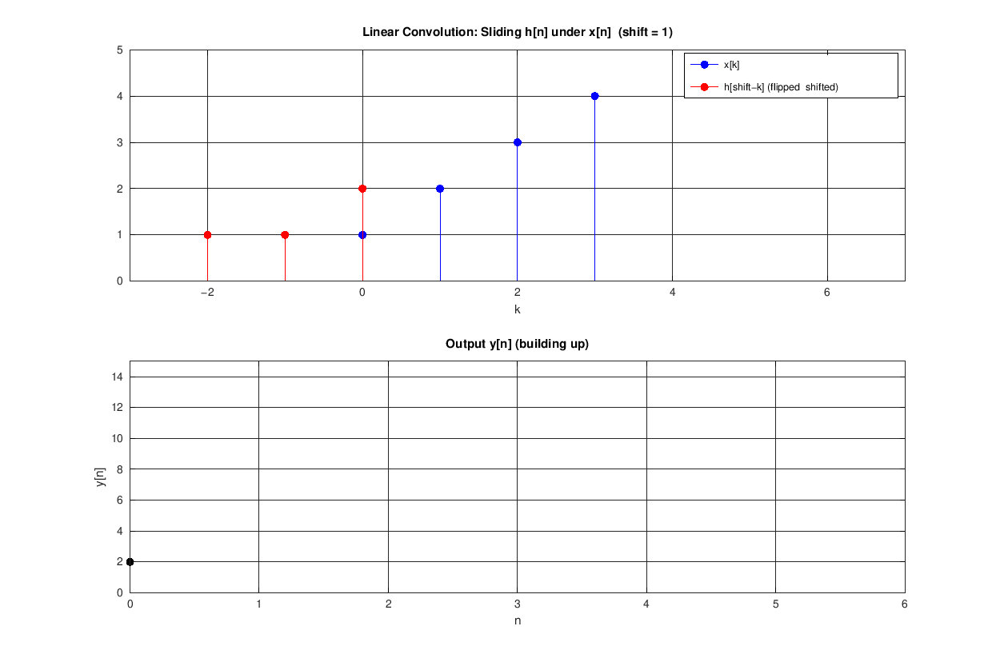
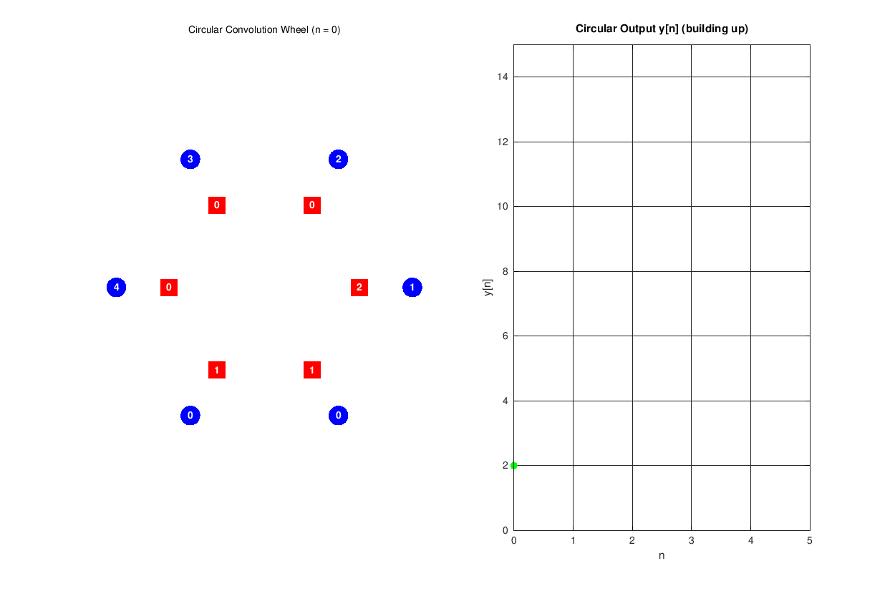
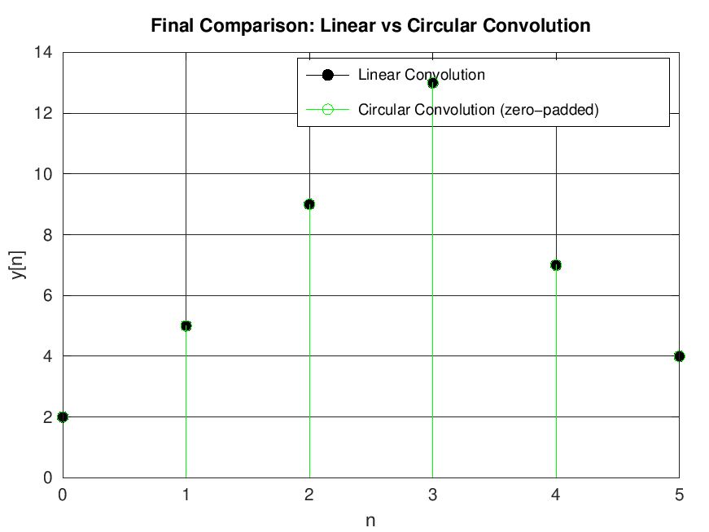
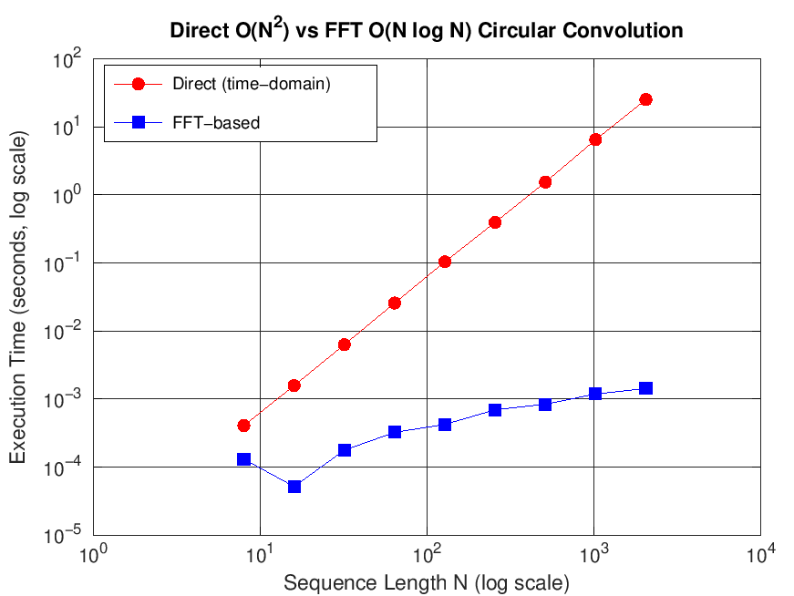
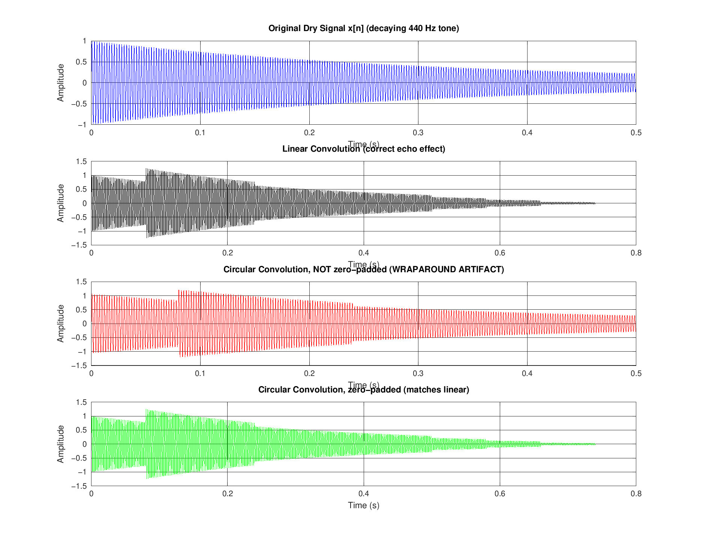

# Linear vs Circular Convolution — DSP Demonstration Project

An Octave/MATLAB project that demonstrates and compares **linear convolution** and **circular (DFT/FFT-based) convolution** of discrete-time sequences — with step-by-step animations, quantitative error metrics, an $O(N^2)$ vs $O(N\log N)$ performance benchmark, and a real-world **audio echo/reverb** application showing why zero-padding matters in FFT-based fast convolution.

---

## 📁 Repository Structure

```
Convolution/
│
├── main.m                       # Entry point — orchestrates all demos
├── linear_conv_demo.m           # "Flip-and-slide" animation (+ GIF export)
├── circular_conv_demo.m         # "Rotating wheel" animation (+ GIF export)
├── compare_results.m            # Metrics table (MSE, RMSE, % error) + report
├── benchmark_performance.m      # Direct O(N²) vs FFT O(N log N) timing
├── audio_echo_demo.m            # Real-world echo/reverb application demo
├── README.md
│
├── Simulations/                 # Sample output plots/animations
│       sample_audio_echo.png
│       sample_benchmark.png
│       sample_circular_conv.gif
│       sample_final_comparison.png
│       sample_linear_conv.gif
│
└── utils/
        circconv_fft.m           # FFT-based circular convolution (vectorized)
        safe_sgtitle.m           # Cross-version sgtitle() fallback
        validate_input.m         # Input sanity checks
```

> Running `main.m` regenerates all of these artifacts (plus `.wav` audio files and CSV/TXT reports) into a local `outputs/` folder.

---

## ⚙️ Requirements

- **GNU Octave** (tested on 6.x / 7.x / 8.x) or **MATLAB** — no extra packages required; everything uses only built-in `fft`/`ifft`, `conv`, and `audiowrite`/`audioread`.
- **ImageMagick** (`convert`) on the system PATH — optional, only needed to assemble animation frames into `.gif` files. Without it, individual PNG frames are still saved.

Run with:
```bash
cd Convolution
octave main.m
```

---

## 🧠 Technical Documentation

### 1. `main.m` — Project Entry Point

Orchestrates the full demo pipeline in order:

1. Defines and validates input sequences `x = [1 2 3 4]`, `h = [2 1 1]` via `validate_input()` (or accepts keyboard input if the commented `input()` lines are enabled).
2. Runs the **linear convolution** animation (`linear_conv_demo`).
3. Runs the **zero-padded circular convolution** animation (`circular_conv_demo`), using `N = Nx + Nh − 1` so its result exactly matches linear convolution.
4. Computes a **minimal-length (aliased)** circular convolution (`N = max(Nx, Nh)`, no zero-padding) directly via `circconv_fft`, to show wraparound distortion numerically.
5. Calls `compare_results()` to tabulate and report error metrics between linear and zero-padded circular results.
6. Produces a **final overlay stem plot** of both outputs, saved as `outputs/final_comparison.png`.
7. Runs `benchmark_performance()` — Direct vs. FFT timing comparison.
8. Runs `audio_echo_demo()` — real-world echo application.

Toggles in `opts`/flags let you turn animation, GIF export, and the benchmark/audio demos on or off independently.

### 2. `linear_conv_demo.m` — Flip-and-Slide Animation

Computes `y_lin = conv(x, h)` and animates the classical **flip-and-slide** interpretation of linear convolution:

- Top subplot: `x[k]` (blue stems) held fixed while `h[shift−k]` (red stems, flipped and shifted) slides across it, frame by frame, for `shift = 1 … Nx+Nh−1`.
- Bottom subplot: the output `y[n]` building up sample-by-sample as the overlap accumulates.
- If `save_gif` is enabled, each frame is written to a temp directory and assembled into `outputs/linear_conv.gif` via ImageMagick's `convert`.
- Animation is automatically skipped (falls back to computing only) if the full output length exceeds `opts.max_len` (default 15), to avoid unwieldy animations for long sequences.

### 3. `circular_conv_demo.m` — Rotating-Wheel Animation

Computes `y_circ = circconv_fft(x, h, N_full)` (zero-padded to `N_full = Nx+Nh−1`, so it exactly equals linear convolution) and visualizes circular convolution as **two sequences of points arranged on a circle**:

- `x` values placed at fixed angular positions (blue circles).
- `h` values (red squares) placed at positions determined by `mod(shift − k, N_full)`, i.e., **h rotating/wrapping around the circle** as `shift` increases — making the "wraparound" nature of circular indexing visually explicit.
- Right-hand subplot shows the output `y[n]` accumulating in parallel, same style as the linear demo.
- Same GIF-export and `max_len` auto-skip behavior as `linear_conv_demo.m`.

### 4. `compare_results.m` — Quantitative Comparison

Given `y_lin` and `y_circ` (equal length), computes:

| Metric | Definition |
|---|---|
| **Max Absolute Error** | `max( abs(y_lin − y_circ) )` |
| **MSE** | `mean( (y_lin − y_circ).^2 )` |
| **RMSE** | `sqrt(MSE)` |
| **Percent Error** | `100 × max_error / max(abs(y_lin))` |

Prints a per-sample results table (`n`, linear value, circular value, absolute error) to the console, and — if `save_report = true` — writes the same data to `outputs/comparison_report.csv` and a plain-text summary to `outputs/comparison_report.txt`. When zero-padding is correct, the max error should be at floating-point-noise level (< 1e-9), confirming linear ≡ zero-padded circular convolution.

### 5. `benchmark_performance.m` — Direct vs. FFT Timing

Benchmarks two implementations of **N-point circular convolution** across sequence lengths `N ∈ {8, 16, 32, 64, 128, 256, 512, 1024, 2048}`:

- **Direct time-domain sum** — a literal double `for` loop implementing `y[n] = Σ_k x[k]·h[(n−k) mod N]`, i.e. **O(N²)**.
- **FFT-based** (`circconv_fft`) — **O(N log N)**.

Timing results are printed as a table and plotted on a **log-log** axis (`outputs/benchmark.png`), making the asymptotic gap between the two approaches visually obvious as N grows.

### 6. `audio_echo_demo.m` — Real-World Application

Demonstrates *why* zero-padding matters using a synthetic audio signal (no microphone or audio toolbox needed):

- **Signal**: a decaying 440 Hz tone, `x = sin(2π·440·t)·e^(−3t)`, sampled at `Fs = 8000 Hz` for 0.5 s (can be swapped for a real `.wav` file via the commented `audioread` line).
- **Impulse response**: a synthetic 3-tap decaying echo (`h`) with echoes at 0.08 s, 0.16 s, and 0.24 s and decreasing amplitude (1.0 → 0.6 → 0.35 → 0.15).
- Computes and times three convolutions:
  1. **Linear** (`conv`) — the physically correct echo effect.
  2. **Circular, unpadded** (`N = Nx`) — produces audible **wraparound distortion**, where the tail of the echo corrupts the beginning of the signal.
  3. **Circular, zero-padded** (`N = Nx+Nh−1`) — matches the linear result exactly while retaining FFT speed.
- Saves 4 `.wav` files (dry signal, linear echo, "bad" wrapped circular echo, correct zero-padded circular echo) plus a 4-panel comparison plot (`outputs/audio_echo_comparison.png`).

### 7. Utility Functions (`utils/`)

| File | Purpose |
|---|---|
| `circconv_fft.m` | Vectorized **N-point circular convolution** via `real(ifft(fft(x,N) .* fft(h,N)))`. Auto zero-pads/truncates both inputs to length `N`. O(N log N). |
| `safe_sgtitle.m` | Cross-version-safe replacement for `sgtitle()` — falls back to a manual `annotation()` textbox on Octave installs that lack `sgtitle`. |
| `validate_input.m` | Sanity-checks a sequence: non-empty, numeric, finite (no NaN/Inf), and coerces to a row vector; throws a descriptive error otherwise. |

---

## 📐 Theory Summary

**Linear convolution** of `x[n]` (length Nx) and `h[n]` (length Nh) produces an output of length `Nx + Nh − 1`:

```
y[n] = Σ_k x[k]·h[n−k]
```

**Circular convolution** of length N wraps indices modulo N:

```
y[n] = Σ_k x[k]·h[(n−k) mod N]
```

**Key relationship:** N-point circular convolution equals linear convolution **if and only if** `N ≥ Nx + Nh − 1` — achieved by zero-padding both sequences before the DFT/FFT. If `N` is smaller (e.g. `N = max(Nx, Nh)`), the result **aliases**: tail samples wrap around and add onto the front of the sequence. This is exactly why real-time DSP, audio, and communications systems using FFT-based fast convolution (e.g. overlap-add / overlap-save methods) always zero-pad their inputs first.

---

## 📊 Results

### Linear Convolution — Flip-and-Slide Animation
Step-by-step build-up of `y[n] = conv(x, h)` as `h[n]`, flipped and shifted, slides across `x[n]`:



---

### Circular Convolution — Rotating-Wheel Animation
`x` and `h` arranged on a circle, with `h` rotating around `x` to illustrate modulo-N wraparound as the zero-padded circular output is built up:



---

### Final Comparison: Linear vs. Zero-Padded Circular
Overlay of both outputs — with correct zero-padding (`N = Nx+Nh−1`), the two convolutions coincide exactly:



---

### Performance Benchmark: Direct O(N²) vs. FFT O(N log N)
Execution time vs. sequence length on a log-log scale, showing the FFT method's asymptotic advantage as N grows:



---

### Real-World Application: Audio Echo/Reverb
Dry signal vs. linear-convolution echo vs. **unpadded circular convolution (wraparound artifact)** vs. correctly zero-padded circular convolution:



---

## 📈 Sample Console Output

```
==============================================================
 LINEAR vs CIRCULAR CONVOLUTION -- DEMONSTRATION PROJECT
==============================================================

x[n] = 1   2   3   4
h[n] = 2   1   1

--- Running Linear Convolution Demo ---
--- Running Circular Convolution Demo (zero-padded) ---
--- Circular Convolution (N=4, ALIASED / no zero-padding) ---

--- Comparing Linear vs Zero-Padded Circular Convolution ---
Max Absolute Error : 0.0000e+00
MSE                : 0.0000e+00
RMSE               : 0.0000e+00
Percent Error       : 0.000000 %
=> Circular convolution (zero-padded) EXACTLY matches linear convolution.

--- Running Performance Benchmark ---
--- Running Real-World Audio Echo Demo ---
Max error, linear vs zero-padded circular: 0.0000e+00

==============================================================
 ALL DEMOS COMPLETE. Check the outputs/ folder for results.
==============================================================
```

---

## 🔑 Key Concepts Demonstrated

- Linear convolution via the "flip-and-slide" method
- Circular (modulo-N / DFT-domain) convolution and index wraparound
- The zero-padding condition `N ≥ Nx + Nh − 1` for linear ≡ circular equivalence
- Quantitative validation via MSE, RMSE, and percent error
- Computational complexity: direct O(N²) vs. FFT-based O(N log N) convolution
- A real-world DSP consequence of insufficient zero-padding: echo/reverb wraparound distortion

---

## 🛠️ Possible Extensions

- Replace the synthetic tone in `audio_echo_demo.m` with a real `.wav` file (see commented-out line in that file).
- Add a GUI front end (`uicontrol` sliders/text boxes) for live parameter entry instead of editing `main.m`.
- Extend `benchmark_performance.m` to compare against Octave/MATLAB's built-in `conv()` as a third baseline.

---

## 📄 License

This project is intended for educational use in digital signal processing / digital communication coursework and self-study.
